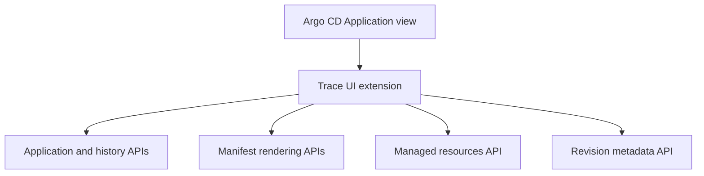

# Argo CD Trace

> Accurate deployment context directly inside the Argo CD Application view.

[Documentação em português](docs/README.pt-BR.md)

Argo CD Trace is a UI extension that adds a **Trace** tab to every Argo CD
`Application`. It brings source, revision, operation, manifest change, live
drift, deployment history, and hierarchy information into one place without a
separate backend.

## What it answers

| Question                              | Trace view                                                             |
| ------------------------------------- | ---------------------------------------------------------------------- |
| What is configured?                   | Git/Helm source, path/chart and target revision                        |
| What is active?                       | Revision reported by sync status, with history fallback made explicit  |
| What just happened?                   | Latest operation, phase, initiator, pruning and selective-sync context |
| What changed between deployments?     | Rendered-manifest resource and field changes                           |
| What is different right now?          | Desired-versus-live managed-resource differences                       |
| Where did this Application come from? | ApplicationSet and App-of-Apps ancestry                                |

## Why accuracy is a feature

Deployment data is easy to overstate. Trace keeps distinct concepts separate:

- desired, active, and historically deployed revisions;
- Git commit authors and Argo CD sync initiators;
- a repeated revision and a confirmed Rollback API action;
- rendered-manifest changes and current live drift;
- unavailable data and an empty result.

Multi-source comparisons require a complete revision set. Historical
comparisons are refused when the recorded source settings conflict with the
current Application specification. Secret values are redacted before display
or caching. See [Accuracy model](docs/accuracy.md) for the full rules.

## Compatibility

| Component           | Supported/tested                                                 |
| ------------------- | ---------------------------------------------------------------- |
| Argo CD             | Validated with `3.2.12`; other versions are currently unverified |
| Node.js             | `22.12+` for contributors; Node `24` is recommended              |
| Browser runtime     | Uses the React instance supplied by Argo CD                      |
| Application sources | Single-source and multi-source Git/Helm Applications             |

Argo CD 3.5 moved its UI from React 16 to React 19. This project uses the
classic JSX runtime and externalizes React, but 3.5+ should still be treated as
unverified until an integration test is added.

## Quick start

```bash
git clone https://github.com/caiomartin/argocd-trace.git
cd argocd-trace
nvm use
npm ci
npm run check
```

The production bundle is written to:

```text
dist/extension-trace.js
```

Argo CD loads JavaScript files whose names start with `extension` from
`/tmp/extensions` in the `argocd-server` Pod. Trace registers itself as a
resource tab for `argoproj.io/Application` and does not bundle React.

## Install in Argo CD

Build the self-contained installer image:

```bash
docker build -f Dockerfile.build -t argocd-trace:v1.8.0 .
```

For a local kind cluster:

```bash
kind load docker-image argocd-trace:v1.8.0 --name kind
```

Apply the included strategic-merge patch to the namespace where Argo CD is
installed:

```bash
export ARGOCD_NAMESPACE=argocd

kubectl patch deployment argocd-server \
  -n "$ARGOCD_NAMESPACE" \
  --type strategic \
  --patch-file k8s/argocd-server-patch.yaml

kubectl rollout status deployment/argocd-server \
  -n "$ARGOCD_NAMESPACE"
```

Open an Application and select the **Trace** tab. See the complete
[installation and troubleshooting guide](docs/installation.md) before using a
remote registry or a customized Argo CD chart.

## Architecture



Requests are same-origin and use the current Argo CD browser session. Trace
does not receive Kubernetes or Git credentials and does not contact Git
providers directly. Details are in [Architecture](docs/architecture.md).

## Optional annotations

| Annotation                                    | Purpose                                                             |
| --------------------------------------------- | ------------------------------------------------------------------- |
| `trace.argocd.io/repository-web-url`          | Override the public repository URL                                  |
| `trace.argocd.io/source-N-repository-web-url` | Override source `N` (zero-based) in a multi-source Application      |
| `trace.argocd.io/parent-application`          | Declare an App-of-Apps parent when tracking metadata is unavailable |

Legacy `navigator.argocd.io/*` keys remain readable during the rename
transition.

## Documentation

- [Portuguese guide](docs/README.pt-BR.md)
- [Installation and troubleshooting](docs/installation.md)
- [Accuracy model and limitations](docs/accuracy.md)
- [Architecture and data sources](docs/architecture.md)
- [Contributing](CONTRIBUTING.md)
- [Security policy](SECURITY.md)
- [Release process](RELEASING.md)
- [Navigator migration](MIGRATION.md)

## Contributing

Issues and pull requests are welcome. Start with
[CONTRIBUTING.md](CONTRIBUTING.md), run `npm run check`, and include tests for
changes to revision, operation, diff, or hierarchy semantics.

## License

Licensed under the [Apache License 2.0](LICENSE).

Argo and Argo CD are trademarks of The Linux Foundation. This project is not
an official Argo project.
