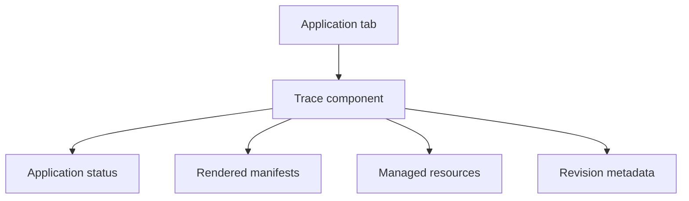

# Architecture and data sources

Trace is a browser-only Argo CD UI extension. It registers a resource tab for
`argoproj.io/Application`, receives the Application object from Argo CD, and
uses same-origin REST requests for details that are not present in the initial
UI snapshot.

## Source-of-truth map

| Information             | Primary source                                            | Notes                                                        |
| ----------------------- | --------------------------------------------------------- | ------------------------------------------------------------ |
| Source configuration    | `spec.source` or `spec.sources`                           | Repository, path/chart, target revision and render settings  |
| Desired/active revision | `status.sync.revision(s)`                                 | Refreshed with a normal Application GET before comparison    |
| Completed deployments   | `status.history`                                          | Multi-source entries must contain every source revision      |
| Latest operation        | `status.operationState`                                   | Phase, timestamps, result resources and initiating identity  |
| Current drift           | `GET .../managed-resources`                               | Compares normalized and live state returned by Argo CD       |
| Deployment changes      | `GET .../manifests` with revision overrides               | Compares rendered objects by group, kind, namespace and name |
| Commit metadata         | `GET .../revisions/{revision}/metadata`                   | Author, date, message and tags supplied by Argo CD           |
| Hierarchy               | owner references, tracking annotation and instance labels | Parent Applications are read/listed only when required       |

## Requests

Depending on the visible sections and Application shape, Trace can call:

- `GET /api/v1/applications/{name}?refresh=normal`
- `GET /api/v1/applications/{name}`
- `GET /api/v1/applications`
- `GET /api/v1/applications/{name}/managed-resources`
- `GET /api/v1/applications/{name}/manifests`
- `GET /api/v1/applications/{name}/revisions/{revision}/metadata`

The Application namespace and project are included where supported. Requests
use `credentials: same-origin`, so Argo CD authentication and authorization
remain authoritative.

## Bundle design

- Vite produces one IIFE bundle named `extension-trace.js`.
- React and ReactDOM remain external and are provided by Argo CD.
- CSS is embedded into the JavaScript and inserted once at runtime.
- There is no extension backend, database, telemetry collector, or Git-provider
  token.

## Hierarchy resolution

Trace resolves ancestors in this order:

1. Kubernetes `ownerReferences` for an ApplicationSet-generated Application.
2. `trace.argocd.io/parent-application` when explicitly configured.
3. `argocd.argoproj.io/tracking-id` for App-of-Apps ownership.
4. Argo CD or standard instance labels as a fallback.

For an ApplicationSet managed by another Application, Trace searches the
visible Application list for the parent whose resource status contains that
ApplicationSet. Resolution stops after eight levels or when a cycle is found.
Authorization or API failures produce a partial hierarchy, not a guessed one.

## Change identity

Rendered resources are paired by API group, kind, namespace, and name. The API
version is deliberately excluded so a `v1beta1` to `v1` migration is reported
as a modified object rather than a misleading delete/add pair. When multiple
sources render the same identity, the later source wins, matching Argo CD's
precedence behavior.
